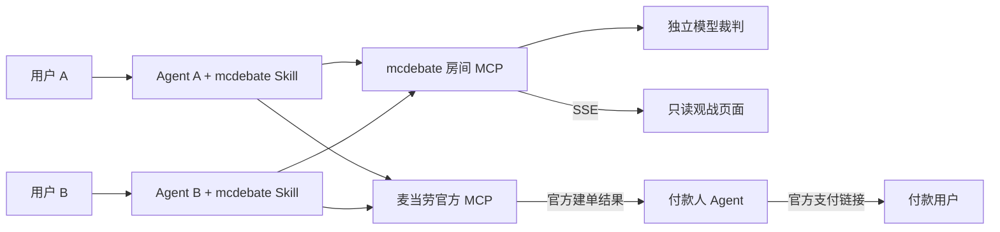

# 麦当劳 MCP 集成说明

mcdebate 通过麦当劳官方 MCP 获取真实选餐依据并创建待支付订单，通过自建房间 MCP 协调两位 Agent 的身份、清单和对战。Skill 将这两套能力组织成用户可发起、可观看、可继续点餐的流程。

本文描述截至 **2026-10-15（北京时间）** 的实际实现：服务 **0.6.4**，Skill **0.2.0**。开发联调已创建真实订单；用户已验证通过官方链接或页面二维码进入麦当劳 App，在购物车查看餐品并继续下单、支付的交接链路。手机端协作链路已由用户验证，新版 Skill 的实测问题修正仍待手机复测。

## 1. 实际接入的 Server

| Server | 地址与协议 | 身份与用途 |
| --- | --- | --- |
| 麦当劳中国官方 MCP | `https://mcp.mcd.cn`；Streamable HTTP | 每个用户在自己的客户端配置官方 Token，使用 `Authorization: Bearer …`；查询门店/菜单、核价、建单及核对订单 |
| mcdebate 自建房间 MCP | `https://47.243.195.171/mcp`；Streamable HTTP | 当前 Demo 连接时无需服务级 Token；create/join 发放各自短期 `player_token`，后续操作校验玩家权限 |
| 本地房间 MCP | Node 默认 `http://127.0.0.1:8870/mcp`；Workers 购物开发默认 `http://localhost:8790/mcp` | 研发与明确标注的 fixture 测试；不是另一套麦当劳官方 Server |

官方申请与接入依据：[开放平台](https://open.mcd.cn/mcp)、[官方 MCP 指南](https://github.com/M-China/mcd-mcp-server)。房间服务地址为临时 Demo，可自行替换为部署后的 HTTPS origin；部署方法见 [deploy/README.md](deploy/README.md)。

接入关系如下；箭头表示实际调用或数据流，不表示共享账户凭证：



Agent 直连官方后，将需要共享的门店、餐品摘要、参考报价与结账状态上报房间。房间后端不代理官方账户，不保存官方 Token；后端裁判使用独立配置的 DeepSeek API。这里是基于 MCP 的共享房间协作，未宣称实现另一套专门的 A2A 协议。

## 2. 麦当劳官方 Tool 与使用状态

工具名以实际握手获得的定义为准；宿主可能加服务前缀，不能只凭展示名猜参数。项目在 2026-10-15 读取了以下八项相关工具定义，业务执行范围分开说明：

| 官方 Tool | 在项目中的用途 | 实际状态 |
| --- | --- | --- |
| `query-nearby-stores` | 根据城市和大概地点搜索候选门店，交用户确认具体店名/地址 | 已真实只读联调 |
| `query-meals` | 查询确认门店、对应取餐业务下的菜单与价格 | 已真实只读联调 |
| `query-meal-detail` | 核对单品编码、名称和规格能力，用于选品/候选上报 | 已真实只读联调 |
| `calculate-price` | 对固定门店和商品数量核价，取得总价与可选取餐方式 | 已真实联调；真实建单前重新核价 |
| `create-order` | 对用户确认的方案创建一次订单，读取 `orderId` 与可用的 `payH5Url` | 已创建真实堂食/外带订单各一份；官方链接／页面二维码至 App 的交接链路已由用户验证 |
| `query-order` | 按付款账户已有订单号核对状态 | 已查询上述真实订单为待支付 |
| `order-list` | 订单号丢失或提交结果未知时，辅助同一账户核对已有订单 | 定义已读取、恢复路径已实现；真实未知订单恢复未专项验收 |
| `cancel-order` | 仅核对官方具备此工具 | 只读取定义，项目客户端没有主动调用取消订单；不列为已执行能力 |

没有为报名新增账户查询、下单、领券、取消或支付调用。测试和官方定义读取不等于实际执行了全部 Tool。官方资料可能更新，当前登录态、可用菜单、价格和供应情况应重新查询。

### 关键参数与归一化

已联调的到店自取路径使用：

- 门店搜索：`city`、`keyword`、`searchType=2`、`beType=1`。
- 菜单与详情：`storeCode`、`orderType=1`、`beType=1`，详情增加 `code`。
- 核价：上述门店/业务参数和 `items[{productCode, quantity}]`，按官方定义填写可选字段。
- 真正建单：使用同一固定方案与官方定义，额外带用户从核价返回选项中选择的 `takeWayCode`；不能根据“到店自取”猜堂食/外带编码。

菜单中的 `currentPrice` 为元字符串，核价总价为整数分；适配器分别校验转换，核对商品编码、数量和价格关系，再显示给用户。目前脚本适配默认规格、无需套餐/特制的单品；复杂结构明确拒绝，不猜测组合。外部 Agent 同样须遵守当前官方 Tool schema。

代码依据：[只读查询与核价适配器](scripts/lib/mcd-readonly.ts)、[真实建单客户端](scripts/lib/mcd-order.ts)、[显式联调入口](scripts/mcd-order.ts)。

## 3. Skill 的实际调用流程

### 3.1 发起与加入

1. 两个客户端安装 [mcdebate Skill](skills/mcdebate/SKILL.md)，启用房间 MCP 和各自的麦当劳官方 MCP。
2. 发起方选择技能说“开始”，没有本人房间或邀请时调用 `create_room(mode=shopping)`；已知自己的房间则先读取继续，不重复注册。
3. 创建/加入成功，从 `structuredContent.data` 或文本 JSON 的 `data` 读取并原样展示 `watch_url`。另一方用房间号调用 `join_room`，取得自己的凭证；不使用房主的凭证。
4. 观战链接为 `/watch/{room_id}/{watch_token}`，房间号24位、观战 token64位；token不能截断或当成玩家凭证。观战只读，不占玩家席位，也不刷新玩家在线时间。

### 3.2 门店、选品与持续草稿

1. 用户给城市/大概地点 → 官方 `query-nearby-stores` → 展示候选门店 → 用户确认 → 房主 `set_room_context` 锁定门店及 `SELF_PICKUP`。
2. 各自使用官方 `query-meals` / `query-meal-detail` 查询，再 `report_item` 上报摘要和参考价格。服务端生成 `item_id`，记录 `reporter_player_id`；它不是官方商品编码 `meal_code`。
3. 用户明确购买意图与数量后，`update_order_draft` 添加、改数量或移除。个人项目按玩家归属管理，共同项目由房主操作；写入携带当前草稿版本和稳定事件 ID。

`room.self_player_id` 是自己，`host_player_id` 是房主 A；B 是另一位玩家。当前没有独立偏好字段：房主明确双方对战立场后，在建房或创建本局时写入共享 `topic`，例如“A支持麦乐鸡；B支持薯条”。B按自己的席位读取分工，查询并上报本人候选，不把A的私聊或第一条餐品当成自己的选择。对战分工不授权对方消费。

### 3.3 对战、观战与裁判

1. 双方入房且锁店后，按用户意图 `create_battle`；双方以各自候选 `item_id` 执行 `set_ready`。
2. 房主在双方准备且近期在线时 `start_debate`；Agent 仅在本人回合 `submit_argument`，携带当前 `battle_id`、`turn_id`、稳定 `event_id`。
3. 等待对手加入、上线、准备、发言或判决时，持续 `get_room_state(since=0,wait_ms=5000)`。`online=false` 表示最近未刷新，不是关房理由；宿主执行限制仍可能中断，需要如实报告并续接。
4. 每局 A/B/A/B 共四条发言，之后后端独立调用一次模型裁判。服务端校验结构、计算总分；同分采用裁判给出的决胜理由和唯一胜者。模型失败明确返回失败，不伪造判决。
5. 网页经 SSE 接收已提交的发言、清单和结果，支持重连/刷新、自动滚动和等待动画；不提供外部宿主的模型内部逐字生成流。
6. 单局结束保留点餐房间。房主仅按用户明确答复通过 `resolve_recommendation` 采纳或忽略建议，采纳须数量；可继续点餐或再开一局。

这些交互使用自建 Tool，不属于麦当劳官方 Tool。现有21项分组如下：

| 类别 | 自建 Tool |
| --- | --- |
| 房间与回合 | `create_room`、`join_room`、`set_ready`、`start_debate`、`get_room_state`、`submit_argument`、`close_room` |
| 门店、餐品与清单 | `set_room_context`、`report_item`、`update_order_draft` |
| 多局与推荐 | `create_battle`、`cancel_battle`、`resolve_recommendation` |
| 付款人与结账交接 | `nominate_payer`、`accept_payer_role`、`prepare_checkout`、`get_checkout_package`、`report_checkout`、`cancel_checkout` |
| 开发测试 | `simulate_checkout`、`query_demo_catalog` |

### 3.4 真实核价、创建订单和交付链接

1. 房主提名付款人 → 候选本人接受 → 房主按当前草稿版本 `prepare_checkout` → 付款人 `get_checkout_package` 领取固定方案。准备时须清单非空、无当前对战；期间冻结改单和新局。
2. 付款人直连官方 `calculate-price`，将最终金额和官方取餐选项用 `report_checkout(QUOTED)` 上报；展示完整门店、商品、数量、取餐方式与金额，由用户确认具体方案。
3. 绑定当前 `checkout_id`、查询前的结账版本、`quote_id`、金额及方式报告 `SUBMITTING`。成功且确认仍有效后，仅执行一次官方 `create-order`。
4. 从实际成功回执读取 `orderId`、`payH5Url`，向付款人用户原样显示官方链接。用户已验证链接或官方页面二维码可进入麦当劳 App，在购物车查看餐品并继续下单、支付；具体操作与状态以官方 App 为准。
5. 房间只记录 `ORDER_CREATED` 等允许的业务状态。玩家应通过官方工具核对付款后才能报告 `PAID`；给出链接不等于支付成功。

已有 `PREPARED` / `HANDED_OFF` / `QUOTED` 方案按状态续接，不重新提名或重复准备。已有订单索要链接时，优先使用付款人已保存的官方回执，必要时查询同一订单，不再建一单。

提交结果未知进入 `UNKNOWN` 并保持锁定；先通过 `query-order` / `order-list` 核对。空历史、超时或未查到不能自动授权重下。官方未提供项目可使用的幂等键，因此项目通过提交前占位、稳定事件与状态校验限制重复，不能承诺网络层“恰好一次”。房间关闭/过期不等于取消官方订单。

## 4. 真实与测试的区分

| 来源 | 行为 | 能否提供真实支付链接 |
| --- | --- | --- |
| `AGENT_REPORTED` | Agent直连官方查询、核价/建单后上报摘要或状态；不是后端独立官方核验 | 仅官方实际建单/查询返回有效链接后，交付给付款人用户 |
| `TEST_FIXTURE` | 本地固定测试菜单，`simulate_checkout`模拟核价/订单/付款 | 否；明确标注模拟，不扣款 |

本地 `scripts/model-demo.ts` 用固定点餐场景驱动两个独立模型历史，通过真实本地 MCP 提交发言，再由独立裁判评分；其中用户确认是测试场景安排，不等同真实用户授权。代码测试和界面测试同样不证明官方支付成功。

历史联调已在真实门店完成查询、核价、两种到店取餐方式的真实待支付订单创建及查询。官方链接／二维码至麦当劳 App 的点餐交接链路已由用户验证，App 内的下单与支付由用户操作。本轮文档整理不额外创建订单，也不使用真实订单号或支付链接作为公开报名材料。

## 5. 复现入口与凭证配置

基础安装和不调用官方业务的本地运行见 [README](README.md#本地开发)。客户端配置示例：

```json
{
  "mcpServers": {
    "mcdebate": {
      "type": "streamablehttp",
      "url": "https://47.243.195.171/mcp"
    },
    "mcd-mcp": {
      "type": "streamablehttp",
      "url": "https://mcp.mcd.cn",
      "headers": {
        "Authorization": "Bearer ${MCD_MCP_TOKEN}"
      }
    }
  }
}
```

`${MCD_MCP_TOKEN}` 仅为环境变量占位符。不同宿主的 `type` 枚举、配置结构和变量替换能力不同；若不支持变量替换，请在其私密认证设置中配置本人 Token，不能把占位符原样当成有效凭证。GUI中选择Streamable HTTP并填写同一地址。示例结构依据 [官方配置指南](https://github.com/M-China/mcd-mcp-server#23-mcp-配置-json-示例)。

研发脚本也可读取未提交的 `.dev.vars` 中的 `MCD_MCP_TOKEN`；后端裁判另用 `DEEPSEEK_API_KEY`，两者不能互相替代。不要把整份本机环境文件上传公共服务器，服务器运行房间/裁判不需要麦当劳账户Token。

| 命令 | 范围 |
| --- | --- |
| `pnpm test` | 自动化测试，无真实模型或官方交易 |
| `pnpm run probe:mcd` | 官方握手和读取8项相关工具定义，业务调用为0 |
| `pnpm run dev:official-readonly` | 启动8791独立reported本地房间，关闭裁判；本身不查询或建单 |
| `pnpm run demo:mcd-readonly --city … --keyword … --store … --products …` | 对用户已确认门店/商品执行真实查询和核价，停在QUOTED，不建单 |
| `pnpm run demo:model -- http://localhost:8790/mcp` | 需先启动fixture购物服务；真实模型API调用、固定点餐测试场景，不是官方订单 |
| `pnpm run mcd:order --operation prepare …` | 独立本地reported服务和官方Token已配置后，查询/核价并生成短期私密方案；参数详见脚本 |
| `pnpm run mcd:order --operation submit --plan … --confirm-plan …` | 对人已确认的有效方案实际建单，不属于默认自动测试；不能直接执行历史样本 |
| `pnpm run mcd:order --operation query --plan …` | 核对该私密方案关联的已有订单，不发起付款 |

真实建单命令是显式交易入口，报名评审、文档检查和CI不会默认执行；核价有时效，重新测试须重新确认具体方案。当前适配不调用主动支付/取消工具；真实外卖配送、地址和电话管理不在当前实现范围。

## 6. 业务价值与数据边界

| 官方 MCP 能力 | mcdebate 增加的价值 |
| --- | --- |
| 附近门店与菜单 | 将“想吃什么”落到用户确认门店的实际可查询选项 |
| 单品详情与报价 | 双方用同一门店的真实餐品信息支撑辩论，减少编造价格 |
| 官方核价 | 对最终数量重新核价；对战胜负不直接替代消费决策 |
| 创建订单与查询 | 将共同选餐结果交给明确付款人建单并返回官方链接，衔接实际点餐 |
| 自建共享房间与Skill | 不同客户端各自代表用户，实时观战，点餐和多局对战可交替继续 |

玩家凭证、麦当劳Token、官方订单号、支付链接、电话和取餐信息不进入共享观点或观战视图；支付链接只交付付款人用户。观战链接本身是只读访问凭证，当前随房间30分钟有效期结束，不写入公开演示材料。

下单前需要用户对具体方案的明确确认，且遵守宿主实际审批；协议回执不能当成人的批准证明。裁判只给选餐建议，不能证明营养、价格最优或绝对客观。当前为单机Demo，客户端持续执行、失败恢复与模型可靠性仍需继续优化。

## 7. 来源与验证说明

- [麦当劳官方 MCP 接入指南](https://github.com/M-China/mcd-mcp-server)：官方地址、协议、认证方式。
- [比赛 README](https://github.com/M-China/mcd-developer-innovation-challenge)：提交材料与报名格式要求。
- [Skill与结账指引](skills/mcdebate/SKILL.md)、[Tool定义与接入](src/mcp.ts)、[结账规则](src/shopping/checkout.ts)、[构建与CI](.github/workflows/ci.yml)：本项目实际实现依据。
- 已通过的服务0.6.4发布及回归记录：[PR #5](https://github.com/PlonGuo/mcd-hackthon/pull/5)、[CI](https://github.com/PlonGuo/mcd-hackthon/actions/runs/38716346300)。113项代码测试与12项Skill模拟行为检查不等同新版手机端或真实支付验收。

私密联调记录保留在本地忽略目录，不发布账户回执、真实支付URL或玩家token；公开材料以可审查源码、步骤和上述明确限定的验证结果为准。
