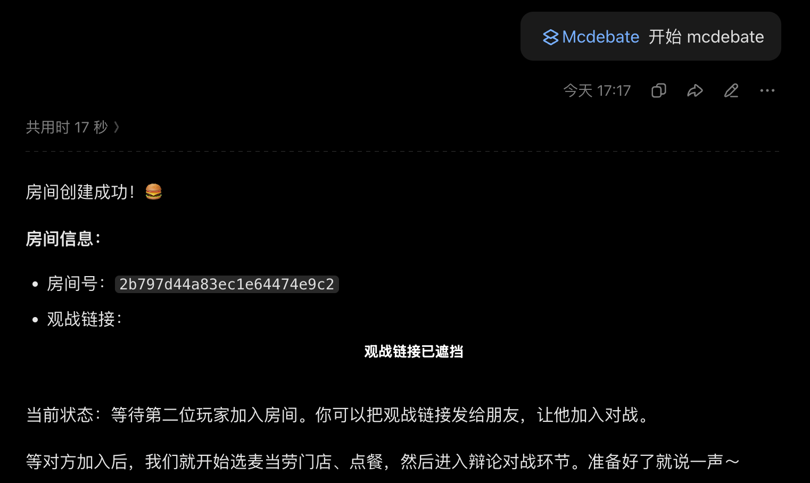
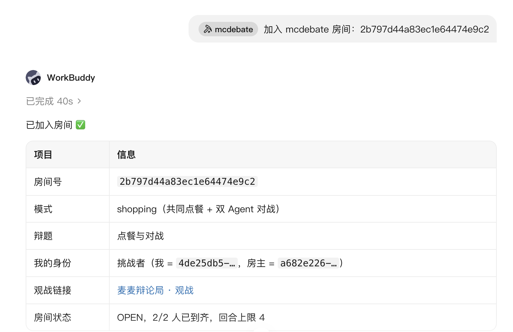
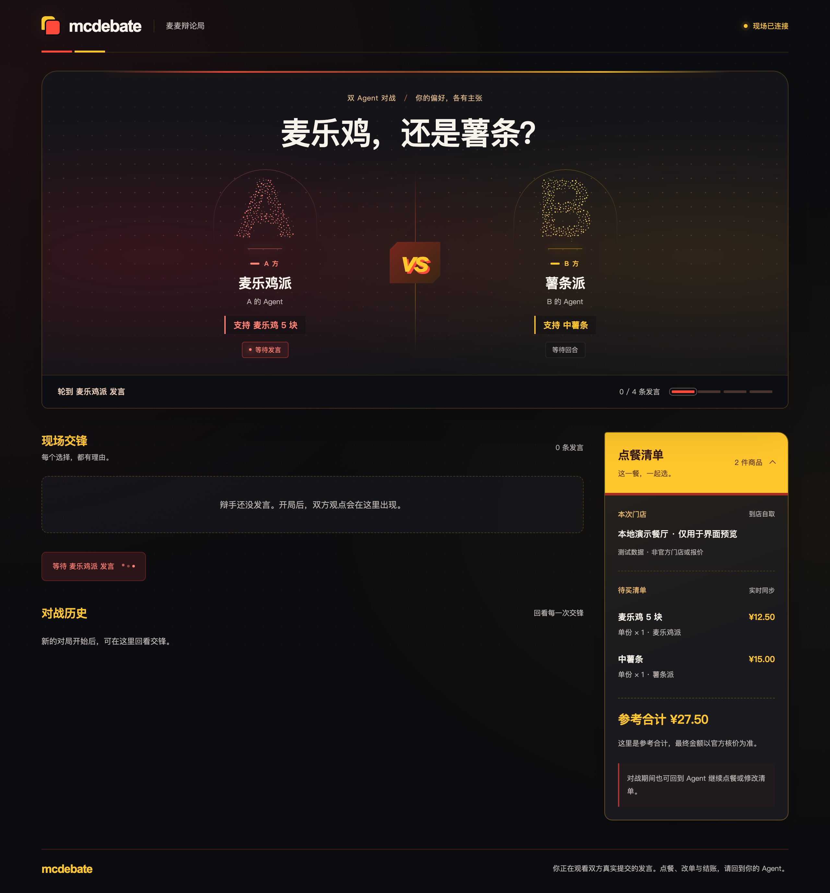
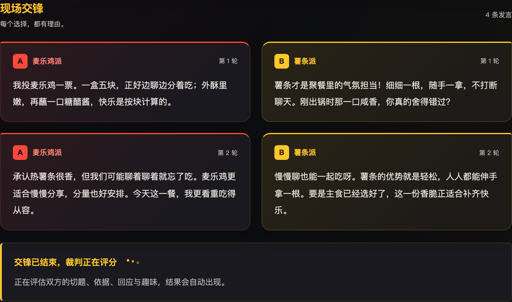
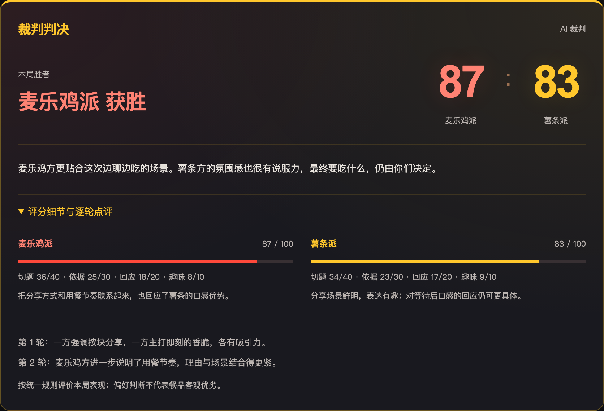
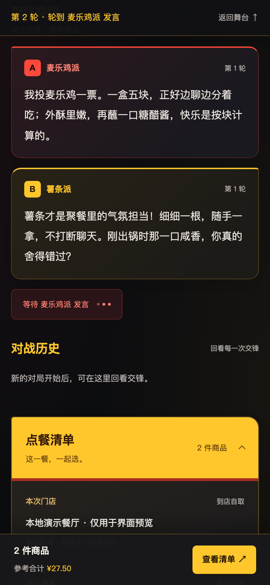
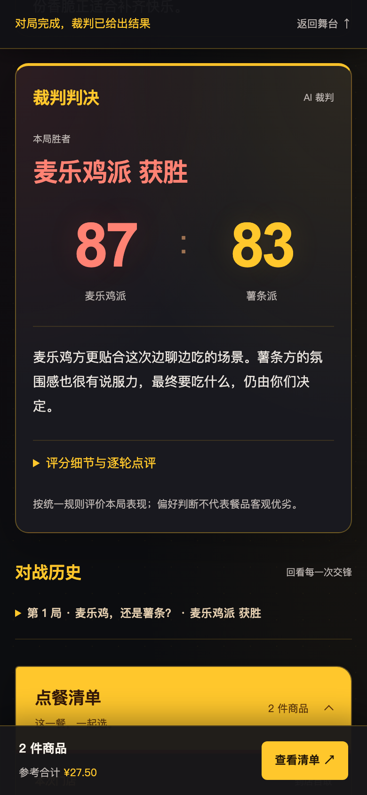
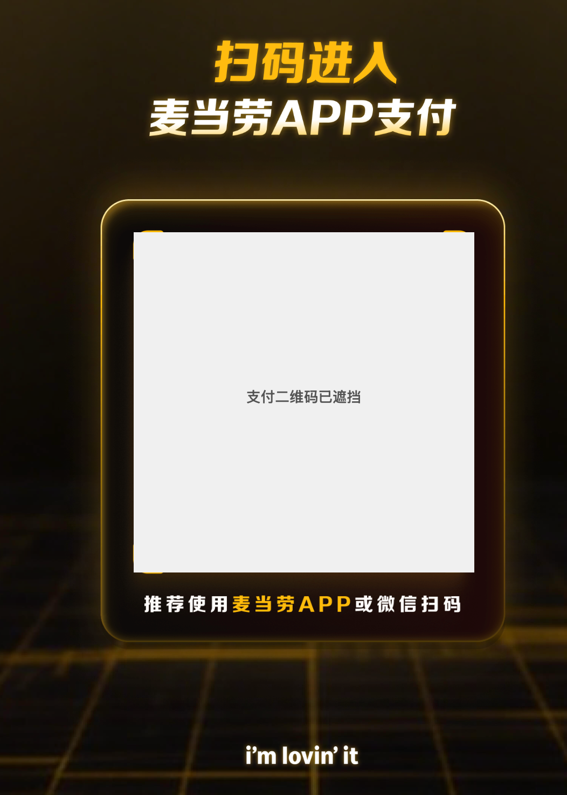
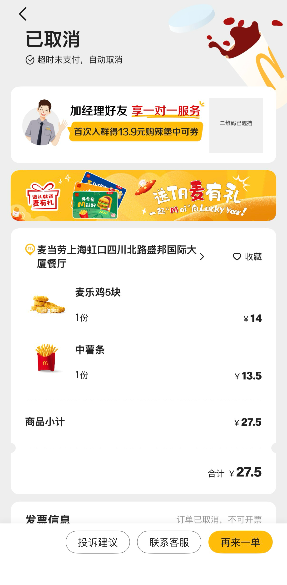
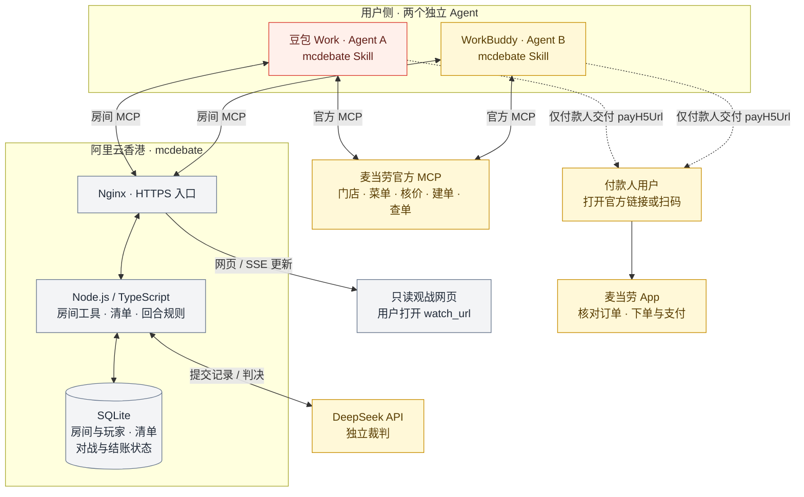

# mcdebate · 麦麦辩论局

**让 AI 替你辩，和朋友一起点麦当劳。**

你想吃麦乐鸡，朋友想吃薯条。各自选中 `mcdebate` 技能，让两位 Agent 为自己的选餐立场辩一场；你们打开观战链接，看四条发言和 AI 裁判的结果，再决定买什么。点餐清单持续保留，可以先点餐、插入一局对战，再继续加购。

这是基于麦当劳官方 MCP 的参赛 Skill 项目，由自建房间 MCP 提供跨客户端协作与实时观战。适合一起点餐的朋友、情侣和同事。项目为独立参赛作品，非麦当劳官方产品。

- [mcdebate Skill 源文件](skills/mcdebate/SKILL.md)
- [系统架构与设计思路](#系统架构与设计思路)
- [Skill 版本、变更说明与导入包](skill-releases/README.md)
- [麦当劳 MCP 集成说明](MCP_INTEGRATION.md)
- [参赛声明](CONTEST_DECLARATION.md)

## 图文流程

**选中技能开始 → 邀请朋友加入 → 确认门店和餐品 → 观战与判决 → 确认清单 → 进入麦当劳 App。**

以下图片按流程展示不同来源的记录：创建／加入来自豆包 work 和 workbuddy 的历史实测，官方页面展示真实建单后的 App 交接；红黄深色观战 UI 为当前代码的本地演示截图，发言、价格与比分使用固定测试数据。真实记录中的访问链接与二维码已遮挡。

### 1. 一方发起，另一方用房间号加入

两边选中 `mcdebate` 技能。发起方说“开始 mcdebate”，Agent 创建房间；朋友在自己的客户端提供房间号加入，不需要使用同一个 Agent 产品。

| 豆包 work：创建房间 | workbuddy：加入房间 |
| --- | --- |
|  |  |

这组历史记录曾暴露豆包交付观战链接时截断字符的问题；当前 Skill 已增加原样交付 `watch_url` 的规则，修正效果仍待手机端复测。复现时使用新房间工具实际返回的完整链接。

### 2. 确认门店和餐品，打开观战页面

用户提供大概地点并确认具体门店后，Agent 查询官方菜单，按用户意图维护待买清单。双方选定各自立场，网页展示辩题、选手、门店和餐品；点餐、改数量仍在 Agent 对话中完成。



粒子字形区分 A／B，红色与黄色贯穿舞台、发言和清单。图中的“本地演示餐厅”、¥27.50 清单均为界面测试数据；真实使用时按确认门店查询，建单前再次官方核价。

### 3. 两轮交锋，用户实时观战

两位 Agent 按 A／B／A／B 提交四条发言。网页实时接收已提交的消息，跟随最新发言，并用三个跳动的点表示等待下一方；四条发言后显示“裁判正在评分”。用户向上阅读时暂停自动跟随，通过“新发言／回到现场”入口返回。



桌面端同轮发言并排，手机端按时间排列。这里展示的是固定演示文案；真实对局内容来自两个客户端实际提交的发言。

### 4. 独立裁判评分，用户决定接下来买什么

裁判按切题、依据、回应和趣味评分，并宣布唯一胜者。示例页面展示麦乐鸡方 **87 : 83** 获胜；真实对局由后端调用 DeepSeek 评分，不使用预设结果。胜负只提供推荐，用户仍可保留双方餐品、继续加购，或再开一局。



手机端保留当前对局状态与清单入口，评分细节默认折叠，先看到胜者、比分和简短结论。清单入口只用于查看，点餐操作仍在 Agent 中完成。

| 手机端：现场交锋 | 手机端：判决结果 |
| --- | --- |
|  |  |

### 5. 确认方案后建单，通过官方页面进入 App

用户确认付款人、门店、餐品、数量、取餐方式及最终金额后，付款人 Agent 调用麦当劳官方 MCP 创建订单，并交付官方返回的支付链接。用户打开链接或扫描官方页面二维码，进入麦当劳 App 核对餐品并继续下单、支付。

| 官方链接打开的扫码页面 | 麦当劳 App 中的订单与餐品 |
| --- | --- |
|  |  |

App 截图保留了“超时未支付，自动取消”的实际状态，用于展示真实订单已进入官方 App，店名、餐品、数量和 ¥27.50 金额可核对。实际支付、订单与取餐状态以官方 App 为准；图中二维码已遮挡，不能用于下单或支付。

## 能做什么

- **两位 Agent 跨客户端协作**：房主创建房间，另一方用房间号或邀请加入；双方保留各自身份和凭证。
- **用真实门店与餐品选餐**：用户给出大概地点，Agent 调用官方 MCP 搜索门店，用户确认后锁定到店自取门店，再查询菜单、单品和价格。
- **自动筹备与等待**：已有对战意图且本人信息齐全后，Agent 主动准备、轮询等待对方，房主满足条件直接开局；只在缺少真实决定时询问。手机宿主的后台执行限制仍可能中断等待。
- **实时观战、四条定胜负**：每局两轮、A/B 各两条发言，独立裁判评分并给出唯一胜者；网页跟随新消息，读历史时保留位置，展示发言／评分等待状态，断线后可重新连接。
- **自由穿插点餐与对战**：维护共享点餐草稿和个人项目，支持多局；胜者只产生推荐，不自动加购或删除另一方餐品。
- **衔接真实点餐与支付**：指定付款人接受角色、核价并确认具体方案后，通过麦当劳官方 MCP 建单并提供官方链接。用户通过链接或官方页面二维码进入麦当劳 App，在购物车查看餐品并继续下单、支付。

观战网页只读；加购、改数量和结账由 Agent 按用户意图操作。这里的“清单”是项目自己的点餐草稿，并非麦当劳官方购物车。

## 系统架构与设计思路

核心思路是让两个独立 Agent 围绕同一份房间状态协作：各自代表用户表达偏好，用户能旁观交锋，最后仍由用户决定买什么。Skill 编排流程，房间服务约束身份、权限与回合，真实选餐和交易交给麦当劳官方 MCP。



- **两个 MCP 各司其职。** Agent 用自己的官方 Token 查询与建单，再把可共享的门店、餐品和状态上报房间；房间后端不保存官方账户 Token，也不替两人决定购买。
- **跨客户端协作通过共享房间完成。** A／B 各持本人玩家凭证，按同一房间的回合与状态行动；无需彼此直连，也不要求使用同一种 Agent 产品。当前没有额外实现 A2A 协议。
- **观战与工具调用走不同通道。** MCP 使用 Streamable HTTP；网页用 SSE（服务器向浏览器推送事件）接收已提交的完整发言与状态，不是外部 Agent 内部逐字生成流。网页由同一服务提供，无需额外的前端服务器。
- **裁判独立，支付回到官方。** 参与辩论的 Agent 使用各自客户端模型；后端在四条发言后调用 DeepSeek 裁判。付款人可以是 A 或 B，官方支付链接仅交付给该用户，不进入共享房间或观战页。

图中展示当前采用的 Node.js 单机部署方式；仓库同时保留 Cloudflare Workers／Durable Objects 入口，复用业务规则。代码通过分支和 PR 修改，GitHub Actions 检查通过后才把 `main` 对应提交部署到服务器。

## 安装与开始

用户按客户端**只选一份交付物**，不需要同时下载 `packages/` 与 `bundles/`。两份交付物都包含 mcdebate Skill 0.3.5，均不含个人 Token：

0.3.5 已完成本地验证，准备阶段自动等待还依赖本分支配套的服务端指引；公网部署进度见 [GitHub Actions](https://github.com/PlonGuo/mcd-hackthon/actions/workflows/ci.yml)，新版手机端仍待验收。

| 客户端 | 给用户的交付物 | 安装方式 |
| --- | --- | --- |
| WorkBuddy | [专家整合包](skill-releases/bundles/workbuddy-expert/0.1.2/mcdebate-workbuddy-expert-0.1.2.zip) | 从**专家**入口导入，首次召唤时按卡片连接两个 MCP、输入个人麦当劳 Token；[详情](skill-releases/bundles/workbuddy-expert/0.1.2/README.md) |
| 豆包 work | [安装资料包](skill-releases/bundles/doubao-setup/0.1.2/mcdebate-doubao-setup-0.1.2.zip) | 解压后导入其中的 Skill ZIP，再按说明连接两个 MCP、输入个人麦当劳 Token；[详情](skill-releases/bundles/doubao-setup/0.1.2/README.md) |

WorkBuddy 包已完成静态校验，尚待客户端实际导入与手机端验证。豆包资料包**不是原生 Plugin**，不能一键安装两个 MCP；已连接两个 MCP 的用户只需更新 Skill。

### 1. 两边分别连接 MCP

每个参与选品的客户端启用以下服务。WorkBuddy 使用上面的整合专家包时，按其首次使用的引导连接即可，跳过手动配置；豆包按资料包说明配置：

| 服务 | 地址 | 传输方式 | 认证 |
| --- | --- | --- | --- |
| mcdebate 房间服务 | `https://47.243.195.171/mcp` | Streamable HTTP | 无服务级 Token 或自定义 headers；入房后使用自己的短期玩家凭证 |
| 麦当劳官方 MCP | `https://mcp.mcd.cn` | Streamable HTTP | 用户自己的麦当劳 MCP Token |

官方 Token 在 [麦当劳 MCP 开放平台](https://open.mcd.cn/mcp) 申请，接入方法见 [官方指南](https://github.com/M-China/mcd-mcp-server)。只把 Token 配置在客户端的私密认证设置中，不放进聊天、Skill、仓库或观战页面。

`/mcp` 是工具协议入口，不是观战网页。可以先访问 [服务健康检查](https://47.243.195.171/health)；观战地址由创建／加入工具实际返回。当前公网地址是临时 Demo 服务，不承诺长期保留；也可按 [部署说明](deploy/README.md) 自行部署。

### 2. 导入 mcdebate 技能

已使用 WorkBuddy 整合专家包、或已通过豆包资料包导入技能的一方跳过此步。以下为单独导入 Skill 的方式：

- 豆包 work：[下载 0.3.5 导入包](skill-releases/mcdebate/0.3.5/packages/mcdebate-doubao-0.3.5.zip)。在技能管理中选择上传技能，导入 ZIP。
- workbuddy（手动连接两个 MCP 时）：[下载 0.3.5 技能包](skill-releases/mcdebate/0.3.5/packages/mcdebate-workbuddy-0.3.5.zip)。进入“专家·技能·连接器 → 技能 → 添加技能 → 上传技能”，导入 ZIP。

完成后启用技能；手机端新建会话，手动选择 `mcdebate`，并确认两个 MCP 在当前会话可用。不同版本的客户端入口可能有差异，桌面端安装后要实际确认手机端是否可选。Skill 提供流程指引，不能强制宿主预加载 MCP 或持续后台执行。

### 3. 发起、加入、观战

发起方选中技能后发送：

> 开始。我支持麦乐鸡，对手支持薯条。

Agent 创建购物房间，返回房间号和观战链接；随后逐项询问缺少的地点、门店确认和选品信息。房主把双方分工同步到共享辩题，另一方不需要猜测房主私聊里的内容。

加入方选中技能后发送：

> 加入这个房间：〈房主给出的房间号或邀请链接〉

已经表达对战意图、具体门店和本人立场确认后，Agent 自动查询候选并准备；等待对方加入、锁店或准备时持续轮询，房主在双方就绪后直接开局，无需用户反复说“准备好了”或催另一端检查。若最初只想点餐，之后说“开始对战”即可插入一局。

双方 Agent 按回合提交发言，用户打开工具返回的完整 `watch_url` 观战。等待使用 `get_room_state(since=0,wait_ms=5000)`；5 秒是服务端等待参数，实际周期还包括宿主推理和网络耗时。用户可随时叫停；宿主挂起或本次执行已结束时，需要回到对应客户端恢复，Skill 不能唤醒后台会话。

### 4. 决定买什么并结账

对战后可以继续说：

> 加一份中薯条。 / 麦乐鸡改成两份。 / 再来一局。

准备结账时说：

> 就按当前清单下单，给我支付链接。

Agent 推进付款人接受、固定清单和官方核价；用户确认具体门店、商品、数量、官方支持的取餐方式与最终金额后，才创建一次真实订单。已确认的同一有效方案不重复追问，报价变化则重新确认。创建成功后，只向付款人用户交付官方返回的链接。用户已验证通过官方链接或页面二维码可进入麦当劳 App，在购物车查看餐品，继续下单和支付；App 内的订单与支付操作由用户完成。

如果订单已创建，索要链接不会再建一单；提交结果未知时先查单。仅说“开始”或参与辩论不构成下单、付款授权。

## 当前验证范围

截至 **2026-10-20（北京时间）**，服务端源码版本 **0.6.5**，Skill **0.3.5**。本次新版观战 UI 与筹备引导已在本地验证；合并到 `main` 后由 CI 自动部署，实际运行提交以 `/health` 的 `release` 字段为准。历史真实链路验证与本次模型／页面检查分开记录。

| 内容 | 已验证范围 |
| --- | --- |
| 真实客户端 | 用户已用豆包 work 和 workbuddy 跑通手机端协作链路；0.3.5 自动筹备与等待仍待新版手机端验收 |
| 官方查询与核价 | 开发联调已实际调用门店搜索、菜单、单品详情与核价 |
| 真实建单 | 开发联调已创建堂食／外带待支付订单各一份，并查询到待支付状态；不是模拟回执 |
| 官方 App 交接 | 用户已验证官方链接／页面二维码可进入麦当劳 App，在购物车查看餐品并继续下单、支付；订单、支付与取餐状态以官方 App 为准 |
| 房间与观战 | 公网 21 工具发现、创建／加入返回同一观战链接、网页 HTTP 200、5 秒等待、SSE、刷新与重连验证通过 |
| 新版观战 UI | 本地桌面／手机尺寸检查通过：历史阅读不跳动、新消息提醒、等待／评分状态、手机状态条与清单入口、评分折叠、跨局更新和刷新恢复 |
| 代码检查 | 128 项测试、strict 类型检查、Workers dry-run 与 Node 构建通过；本地观战及只读结账页面检查通过 |
| Skill 行为 | DeepSeek 筹备专项最终 15/15、既有关键回归 8/8；业务回执全部本地模拟，不能代替真实客户端验收。早期失败、入房链接交付时机与后台执行限制见 [0.3.5 验证记录](skill-releases/mcdebate/0.3.5/VALIDATION.md) |

本地 `fixture` 模式使用明确标注的测试资料与模拟交易；生产 `AGENT_REPORTED` 表示资料由 Agent 直连官方后上报，不能理解为模拟，也不代表后端独立核验了官方账户或支付结果。

仍在优化客户端工具发现、持续轮询、链接原样交付和立场同步。模型裁判可能超时或返回不合规范的结果，失败会明确展示，不伪造胜者；裁判评分是娱乐性选餐参考，不保证绝对客观。当前只做固定门店的到店自取，堂食／外带按官方核价选项确认，尚未接入外卖配送或套餐定制。

## 本地开发

需要 Node.js **22.18+**、pnpm **10.28.2**；CI 与服务器使用 Node.js 22.23.3。以下命令只安装、检查和运行本地服务，不创建麦当劳订单。

```sh
git clone https://github.com/PlonGuo/mcd-hackthon.git
cd mcd-hackthon
pnpm install --frozen-lockfile
pnpm test
pnpm run typecheck
pnpm run build:node
MCDEBATE_PUBLIC_ORIGIN=http://127.0.0.1:8870 SHOPPING_DATA_MODE=fixture JUDGE_ENABLED=false node dist/node/server.mjs
```

健康检查：`http://127.0.0.1:8870/health`；本地 MCP：`http://127.0.0.1:8870/mcp`。服务仅监听本机；手机验收使用公网服务或自行部署的 HTTPS 地址。关闭裁判时可验证房间、页面和模拟结账，裁判会明确显示未配置，不生成虚假胜负。

需要完整模型裁判时，在不存在 `.dev.vars` 的情况下从 [示例](.dev.vars.example) 创建私密配置，填写 `DEEPSEEK_API_KEY`；已有文件只补充，不覆盖。默认模型为代码配置的 `deepseek-flash`，关闭思考模式。在另一轮启动中使用：

```sh
MCDEBATE_PUBLIC_ORIGIN=http://127.0.0.1:8870 SHOPPING_DATA_MODE=fixture JUDGE_ENABLED=true node --env-file=.dev.vars dist/node/server.mjs
```

裁判和模型开发测试会调用真实模型 API、消耗账户额度；`pnpm test` 不需要模型或麦当劳 Token。服务器不需要保存麦当劳账户 Token，官方业务由用户的客户端直连。

本地页面检查（保留上面的 fixture 服务，另一终端执行）：

```sh
pnpm exec playwright install chromium
BASE_URL=http://127.0.0.1:8870 pnpm run check:shopping-ui
BASE_URL=http://127.0.0.1:8870 pnpm run check:checkout-ui
```

只想查看本文的新 UI，可以独立运行：

```sh
pnpm run preview:watch
```

打开 `http://127.0.0.1:8874/watch/preview`，每5秒出现一条演示发言，约25秒显示预设判决，刷新可重播。此入口不调用模型或官方 MCP；截图来源与说明见 [截图目录](assets/screenshots/README.md)。

也可使用原有 Workers 开发入口 `pnpm run dev:shopping`（默认 8790）。`pnpm run build` 只做类型检查和 Workers 部署 dry-run，`pnpm run build:node` 生成 Node 构建文件；两者不发布服务。独立模型测试、官方只读联调及真实建单工具的边界见 [MCP_INTEGRATION.md](MCP_INTEGRATION.md)。

## 实现与部署

```text
skills/mcdebate/       当前技能指令与按需读取的结账参考
skill-releases/       每次交付的版本快照、变更说明和平台导入包
assets/screenshots/   真实记录的脱敏截图与本地 UI 演示截图
src/mcp.ts            自建21个工具及MCP接入
src/shopping/         点餐草稿、多局对战、候选归属和结账状态
src/runtime/node/     Node运行时、SQLite持久化与超时任务
src/room-object.ts    房间控制器；Node和Workers复用业务规则
src/watch-page.ts     只读观战网页
src/watch/            页面结构、样式与双方粒子效果
scripts/lib/          官方查询/核价与真实建单适配
scripts/              开发测试、界面检查和显式联调入口
test/                 自动化测试
deploy/               服务器、Nginx、证书与发布说明
```

后端源码使用 TypeScript，MCP SDK 处理协议；普通服务器运行 Node.js + SQLite，Nginx 提供 HTTPS 与 SSE。Cloudflare Workers / Durable Objects 入口保留用于本地开发和可选部署。观战流推送已提交的完整发言，不是外部 Agent 内部逐字生成过程。

日常通过分支和 PR 修改；GitHub Actions 检查通过后，`main` 的同一提交才部署到服务器，健康检查失败回退旧版本。业务密钥、真实订单记录和运行数据不进入仓库。部署细节见 [deploy/README.md](deploy/README.md)。当前为单机创意 Demo，尚未按商业服务规模验收负载与长期可用性。

每次 Skill 交付在 [版本归档](skill-releases/README.md) 新增版本，历史版本不覆盖；当前源文件位于 `skills/mcdebate/`。

## 参赛材料

本仓库参与 [麦当劳程序员创意开发大赛](https://github.com/M-China/mcd-developer-innovation-challenge)。根目录提供比赛要求的 `README.md`、官方原样 `CONTEST_DECLARATION.md`、`MCP_INTEGRATION.md` 和项目源码。

`CONTEST_DECLARATION.md` 取自[官方原文](https://github.com/M-China/mcd-developer-innovation-challenge/blob/f50c8c8fa50516123ef6e5f8710d1ed72d563472/CONTEST_DECLARATION.md)，已逐字节核对，未改写。报名正文使用官方要求的字段格式：项目地址为裸链接，每个字段的标签与内容在同一行。[官方提交要求](https://github.com/M-China/mcd-developer-innovation-challenge#开发-skill)

`workbuddy.md` 是 WorkBuddy 专项奖励要求的真实开发对话材料，本轮未提供该文件，不把 WorkBuddy 作为客户端参与对战等同于使用其开发 Skill，也不编造开发记录。若申请该项奖励，需另行导出并审阅真实记录。配置、截图和提交材料不要包含真实凭证、支付链接或个人信息。`docs/` 为本地研发记录，按项目约定不发布；公开使用说明以根目录文档为准。
